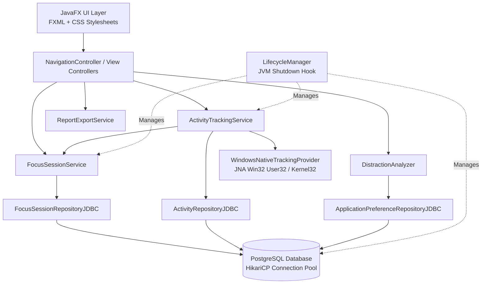
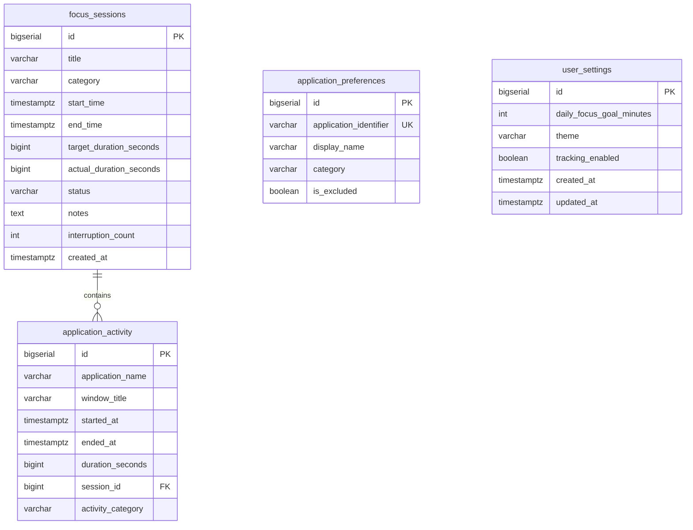

# FlowState Architecture & Technical Reference

FlowState is a native Java 21 desktop application engineered to track computer usage, measure deep-work focus sessions, identify real-time distraction patterns, and analyze productivity trends. Built for a college-level B.Tech CSE project, it demonstrates professional Java Object-Oriented Programming (OOP), multithreading, concurrency control, PostgreSQL JDBC persistence, native Windows operating system integration via JNA, and modern JavaFX UI engineering.

---

## 1. High-Level Architecture

The application adopts a layered, modular architecture with clear separation of concerns across UI presentation, business domain services, native hardware/OS tracking providers, and relational persistence.



---

## 2. Package Structure & Responsibilities

```
com.flowstate
├── FlowStateApp.java          # JavaFX Application entry point and stage bootstrapper
├── Main.java                  # Standalone launcher to bypass JavaFX runtime classpath module checks
├── analytics                  # Transparent rule-based distraction detection heuristics
│   ├── DistractionAnalyzer.java
│   └── SessionDistractionMetrics.java
├── config                     # Configuration and database connectivity
│   ├── AppConfig.java         # Hierarchical config loader (env vars, properties files)
│   └── DatabaseManager.java   # HikariCP connection pool, schema migrator, diagnostic engine
├── model                      # Core domain entities and enums
│   ├── AppCategory.java       # PRODUCTIVE, DISTRACTING, NEUTRAL
│   ├── ApplicationActivity.java
│   ├── ApplicationPreference.java
│   ├── FocusSession.java
│   ├── SessionCategory.java   # CODING, STUDYING, READING, WRITING, RESEARCH, OTHER
│   ├── SessionStatus.java     # PENDING, RUNNING, PAUSED, COMPLETED, CANCELLED
│   └── UserSettings.java
├── repository                 # Data Access Object (DAO) layer using JDBC prepared statements
│   ├── ActivityRepository.java
│   ├── ActivityRepositoryJDBC.java
│   ├── ApplicationPreferenceRepository.java
│   ├── ApplicationPreferenceRepositoryJDBC.java
│   ├── FocusSessionRepository.java
│   └── FocusSessionRepositoryJDBC.java
├── service                    # Domain business logic and lifecycle orchestrators
│   ├── FocusSessionListener.java
│   ├── FocusSessionService.java
│   ├── LifecycleManager.java
│   └── ReportExportService.java
├── tracking                   # Operating system window detection and sampling
│   ├── ActivityChangeListener.java
│   ├── ActivityTrackingProvider.java
│   ├── ActivityTrackingService.java
│   ├── ForegroundAppInfo.java
│   └── WindowsNativeTrackingProvider.java
└── ui                         # Presentation controllers and view models
    ├── ActivityMonitorController.java
    ├── AnalyticsController.java
    ├── DashboardController.java
    ├── FocusTimerController.java
    ├── NavigationController.java
    ├── Refreshable.java
    ├── ReportsController.java
    ├── SessionHistoryController.java
    ├── SettingsController.java
    └── model
        └── AppUsageSummary.java
```

---

## 3. Multithreading, Synchronization & Concurrency

### 3.1 Concurrency Model
The application coordinates multiple dedicated thread pools to guarantee that long-running calculations, file writes, and database queries never freeze the 60fps JavaFX Application Thread:

1. **JavaFX Application Thread (`Platform.runLater`)**:
   - Handles all GUI events, scene graph animations, and control updates.
   - Database operations are strictly prohibited on this thread.
2. **Focus Timer Scheduler (`FlowState-FocusTimer`)**:
   - A daemon `SingleThreadScheduledExecutor` executing second ticks.
   - Calculates elapsed duration using wall-clock `java.time.Instant` intervals rather than relying on an incrementing loop counter, preventing timer drift across OS thread suspension or window minimization.
3. **Activity Tracker Scheduler (`FlowState-ActivityTracker`)**:
   - Samples the foreground window every 1.5 seconds.
   - Interacts with Win32 APIs in sub-millisecond execution times (<0.2% CPU).
4. **Asynchronous Task Workers (`CompletableFuture.runAsync()`)**:
   - Database queries, analytical chart aggregations, and CSV disk exports are dispatched to asynchronous worker threads. Results are posted back to the UI via `Platform.runLater()`.

### 3.2 Thread-Safety Guarantees
- **Single Active Session Constraint**: `FocusSessionService` guards against concurrent session creation using `AtomicReference<FocusSession>` and synchronized state transition methods (`startSession`, `pauseSession`, `resumeSession`, `completeSession`, `cancelSession`). Attempting to start an overlapping session throws `IllegalStateException`.
- **Thread-Safe Observers**: Event notification lists use `CopyOnWriteArrayList<FocusSessionListener>` and `CopyOnWriteArrayList<ActivityChangeListener>`, allowing listeners to be added or removed dynamically without `ConcurrentModificationException`.
- **Preference Cache**: `DistractionAnalyzer` caches user application rules in a `ConcurrentHashMap<String, ApplicationPreference>` to achieve instant $O(1)$ classification during high-frequency tracking ticks without hitting the database.

---

## 4. Native Windows OS Integration & Privacy Guardrails

### 4.1 Native API Invocation via JNA
Instead of launching heavy external shell processes (`powershell.exe` or `cmd.exe`), `WindowsNativeTrackingProvider` uses the Java Native Access (JNA) library to make direct Win32 user and kernel calls:
- `User32.INSTANCE.GetForegroundWindow()`: Retrieves the window handle (`HWND`) of the currently active window.
- `User32.INSTANCE.GetWindowText()`: Extracts the title bar text of the foreground window.
- `User32.INSTANCE.GetWindowThreadProcessId()`: Retrieves the process ID (`PID`) owning the window.
- `Kernel32.INSTANCE.OpenProcess()` & `QueryFullProcessImageName()`: Retrieves the executable image path (e.g. `chrome.exe`, `idea64.exe`).

### 4.2 Strict Privacy Guardrails (TRAK-06)
- **Zero Keylogging**: The application registers zero low-level keyboard hooks (`WH_KEYBOARD_LL`). No keystrokes or user inputs are captured.
- **Zero Screen Capture**: No screen pixels, desktop screenshots, or window images are captured or stored.
- **Zero Clipboard Monitoring**: FlowState does not inspect or touch the system clipboard.
- **Exclusion Filtering**: Users can flag sensitive applications (e.g., password managers, banking software) as excluded; excluded applications are immediately dropped from tracking and never written to disk or database.

---

## 5. Transparent Rule-Based Distraction Analysis

Distraction analysis operates on transparent, explainable logic rather than black-box machine learning models:

```
[Previous App: PRODUCTIVE] ──── switch to ────> [Current App: DISTRACTING]
                                  │
                                  ▼
                         INTERRUPTION RECORDED!
                         (Deep-Work Streak Resets)
```

- **Legitimate Work Transitions**: Switching between `PRODUCTIVE` and `NEUTRAL` (e.g. IDE to documentation or terminal) is recognized as valid research work and is **never** counted as an interruption.
- **Focus Percentage**:
  $$\text{Focus Percentage} = \frac{\text{Productive Seconds}}{\text{Total Session Seconds}} \times 100$$
- **Deep-Work Streak**: Calculates the longest continuous interval where the user remained in productive or acceptable neutral applications without triggering a distracting switch.

---

## 6. PostgreSQL Database Schema



- **Connection Pool**: Powered by `HikariCP` configured for maximum throughput and automatic connection health validation (`testWhileIdle`, `connectionTimeoutMs = 3000`).
- **SQL Injections Prevention**: 100% of database queries use parameterized `PreparedStatement` interfaces.
- **Automated Schema Migration**: On boot, `DatabaseManager` runs schema initialization (`db/schema.sql`) creating all necessary tables, indexes, and initial configuration rows.
